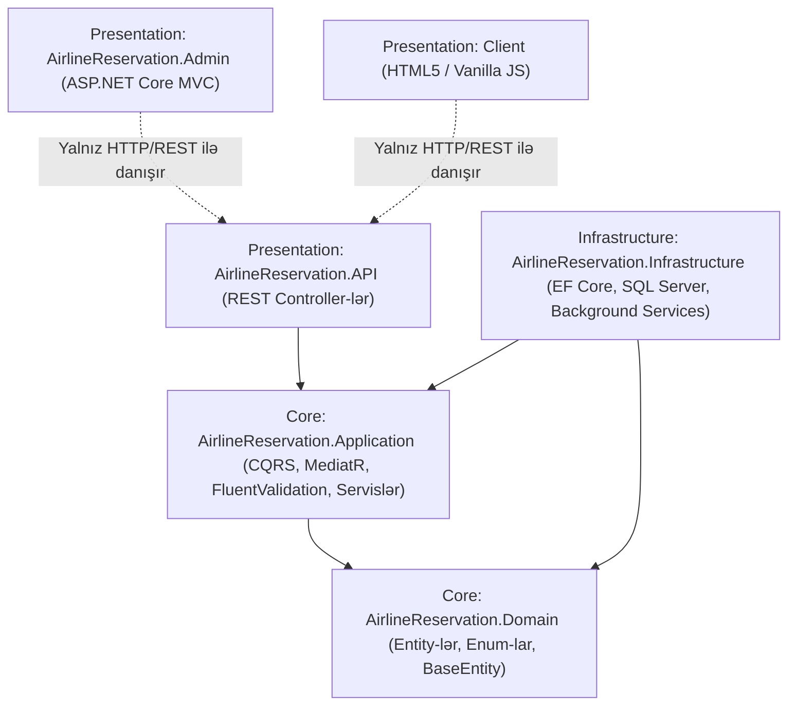
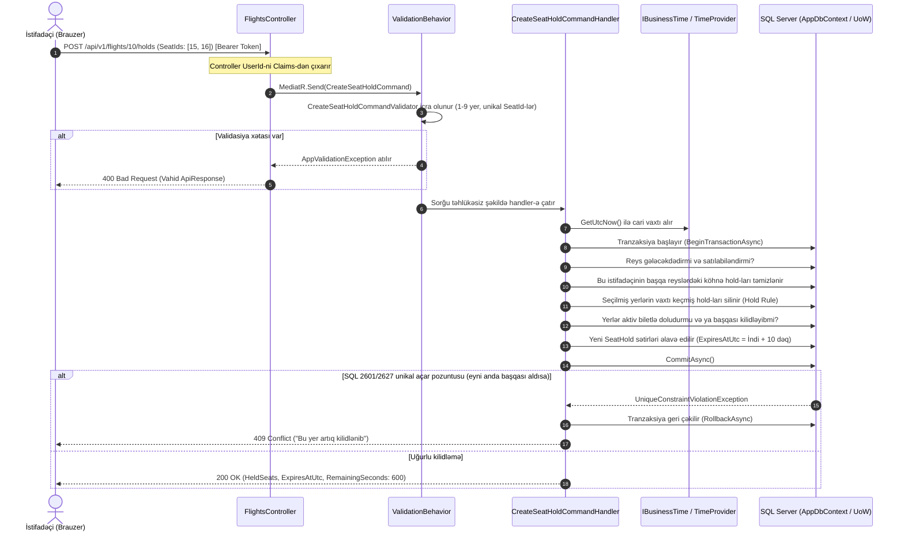

# SkyReserve (AirlineReservationSystem) — Gün 1–15 Bələdçisi (BELEDCI.md)

Bu sənəd **SkyReserve** layihəsinin ilk 15 günündə (Faza 1-in birinci hissəsi) qurulmuş bütün memarlıq, verilənlər bazası, biznes qaydaları və təhlükəsizlik mexanizmlərini dərindən anlamaq və müdafiəyə hazırlaşmaq üçün hazırlanmışdır.

---

## Mündəricat
1. [Layihənin Arxitekturası (Clean Architecture)](#1-layihənin-arxitekturası-clean-architecture)
2. [Gün-Gün İcra Cədvəli (Gün 1–15)](#2-gün-gün-icra-cədvəli-gün-115)
3. [Texniki Lüğət (Glossary & Terminlər)](#3-texniki-lüğət-glossary--terminlər)
4. [Verilənlər Bazası Modeli və Oturacaq Həyat Tsikli](#4-verilənlər-bazası-modeli-və-oturacaq-həyat-tsikli)
5. [Bir Sorğunun İzlənməsi (End-to-End Request Flow)](#5-bir-sorğunun-izlənməsi-end-to-end-request-flow)
6. [12 İmtahan Sualı və Ətraflı Cavabları](#6-12-imtahan-sualı-və-ətraflı-cavabları)

---

## 1. Layihənin Arxitekturası (Clean Architecture)

Layihə Robert C. Martin-in **Clean Architecture** (Soğan / Onions) prinsiplərinə əsaslanır. Əsas prinsip: **Daxili qatlar xarici qatlardan asılı ola bilməz.**



### Qatların Məsuliyyətləri:
1. **Domain (`AirlineReservation.Domain`):**
   - Heç bir xarici paketdən və ya framework-dən asılı deyil (saf C#).
   - Layihənin əsas varlıqlarını (`Airport`, `Flight`, `Seat`, `SeatHold`, `Booking`, `Ticket`, `Payment`) və enum-ları ehtiva edir.
2. **Application (`AirlineReservation.Application`):**
   - Bütün biznes məntiqi burada cəmlənir.
   - **MediatR (v12.5.0):** CQRS pattern (Command-lar və Query-lər).
   - **FluentValidation:** Sorğuların (DTO) doğrulanması və `ValidationBehavior` avtomatik yoxlama boru xətti.
   - **Pure Servislər:** `PricingService` (qiymət alqoritmi), `PnrGenerator` (kriptoqrafik kod istehsalı), `BusinessTimeService` (Bakı saat qurşağı ilə sərhədlər).
3. **Infrastructure (`AirlineReservation.Infrastructure`):**
   - Verilənlər bazası ilə fiziki əlaqə (`AppDbContext`, EF Core 10).
   - `GenericRepository` və `UnitOfWork` pattern-ləri.
   - SQL xətalarının (məsələn, 2601/2627 unikal açar pozuntuları) domen exception-larına tərcüməsi.
   - Arxa plan təmizlik xidməti (`HoldCleanupService` BackgroundService).
4. **API (`AirlineReservation.API`):**
   - Xarici dünyaya açılan qapı (RESTful JSON).
   - JWT autentifikasiyası və Rate Limiting.
   - `GlobalExceptionHandlerMiddleware`: Bütün gözlənilməz və ya biznes xətalarını vahid `ApiResponse<T>` formatında qaytarır.
5. **Hibrid Müştərilər:**
   - **Admin (MVC):** API-yə `HttpClient` vasitəsilə müraciət edir (bağlılıq sıfırdır).
   - **Client (JS/HTML):** İstifadəçi üçün sürətli single-page interfeysi.

---

## 2. Gün-Gün İcra Cədvəli (Gün 1–16)

| Gün | Əsas Mövzu | Əsas Nəticə və Həll Olunan Problem | Əsas Fayllar və Commit-lər |
|---|---|---|---|
| **Gün 1** | Həllin Qurulması (Solution Setup) | .NET 10 Clean Architecture həlli quruldu, `AGENT_RULES.md` və GitFlow qaydaları bərqərar edildi. | `AirlineReservationSystem.slnx` |
| **Gün 2** | Domen Varlıqları (Domain Entities) | Bütün cədvəllərin modelləri yaradıldı. `BaseEntity` (soft-delete `IsDeleted`), Enum-lar təyin olundu. | `Flight`, `Seat`, `Ticket`, `Booking`, `Payment` |
| **Gün 3** | EF Core 10 & SQL Server | `AppDbContext`, Fluent API konfiqurasiyaları, qlobal `!IsDeleted` filtrləri və filtrli unikal indekslər quruldu. İlk miqrasiya yaradıldı. | `AppDbContext.cs`, `20261108..._InitialCreate.cs` |
| **Gün 4** | Realist Verilənlər Bazası Toxumu (Seed) | 7 aeroport, 4 aviaşirkət, 8 təyyarə, 1488 yer və 60 günlük heç vaxt üst-üstə düşməyən hub reysləri toxumlandı. | `AppDbContextSeed.cs`, `SeedData.cs` |
| **Gün 5** | Repository & Unit of Work | Bazaya birbaşa `DbContext` ilə yox, `IUnitOfWork` və `IGenericRepository` vasitəsilə tranzaksiyalı giriş təmin edildi. | `UnitOfWork.cs`, `GenericRepository.cs` |
| **Gün 6** | MediatR CQRS & Exception Handler | MediatR 12.5.0 boru xətti, `ApiResponse<T>` vahid zərfi, `ValidationBehavior` və `GlobalExceptionHandlerMiddleware` quruldu. | `ApiResponse.cs`, `ValidationBehavior.cs`, Middleware |
| **Gün 7** | Identity, JWT & Hardening | `AppUser : IdentityUser<Guid>`, Token servisi, Rate Limiting (`login`), `IBusinessTime` və `TimeProvider` vaxt idarəetməsi əlavə edildi. | `JwtTokenService.cs`, `BusinessTimeService.cs` |
| **Gün 8** | Uçuş Axtarışı və Detalları (F1) | `SearchFlightsQuery`, `GetFlightDetailsQuery` və `FlightsController` ilkin versiyası yazıldı. | `SearchFlightsQueryHandler.cs`, `FlightsController.cs` |
| **Gün 9** | Axtarışın SQL Optimizasiyası | InMemory süzmə ləğv edildi, dəqiq 2 SQL sorğusu (Data + Count), alt sorğu ilə boş yer sayı və `OFFSET/FETCH` səhifələməsi yazıldı. | `FlightRepository.cs`, `cad120d`, `4f1bf77` |
| **Gün 10** | Dinamik Qiymət Mühərriki | Baza qiymət, doluluq dərəcəsi (<50% 1.0x, 50-80% 1.15x, >80% 1.30x), uçuşa qalan vaxt (<72 saat 1.20x) və yer sinfi çarpanları hesablandı. | `PricingService.cs`, `IPricingService.cs` |
| **Gün 11** | Oturacaq Düzülüş Generatoru | Dar və geniş gövdəli təyyarələr üçün cərgə və yer generatoru (`SeatLayoutGenerator`) və SVG xəritə generatoru quruldu. | `SeatLayoutGenerator.cs`, `SvgSeatMapGenerator.cs` |
| **Gün 12** | İnteraktiv Yer Xəritəsi (F4) | `GET .../seatmap` endpoint-i: kabin cərgələri, yerlər və hər yer üçün qiymətin `PricingService` ilə qəpiyinə qədər paritet uyğunluğu təmin edildi. | `GetFlightSeatMapQueryHandler.cs` |
| **Gün 13** | Sifariş Qiymətləndirmə (Quote) | Çoxsaylı yerlərin cəmi qiymətini hesablamaq üçün `POST .../quote` endpoint-i yazıldı. Xəritə ilə quote qiyməti tam eyniləşdirildi. | `GetBookingQuoteQueryHandler.cs` |
| **Gün 14** | Verilənlər Bazası Əsaslı Oturacaq Kilidi (SeatHold) | 10 dəqiqəlik yer kilidi (`SeatHold`), unikal SQL indeksi (ikiqat hold-un qarşısı), rollback təhlükəsizliyi, `HoldCleanupService` və delta xəritə statusu endpoint-i. | `SeatHold.cs`, `CreateSeatHoldCommandHandler.cs`, `HoldCleanupService.cs` |
| **Gün 15** | PNR Generator və Checkout Validasiyası | 32 simvollu kriptoqrafik 6 hərfli PNR (`RandomNumberGenerator.GetItems`), kart təhlükəsizliyi (maskalanmış ToString, echo qadağası), Azərbaycan adları dəstəyi. | `PnrGenerator.cs`, `CheckoutCommandValidator.cs` |
| **Gün 16** | Checkout Mühərriki & Hold İstehlakı (F6) | Vahid ACID tranzaksiyada hold yoxlanışı, `PricingService` ilə server qiymət hesablanması, `IPaymentGateway` ödəniş, unikal PNR, biletlər (`ET-{pnr}-{seat}`), hold-ların silinməsi və paralel checkout testi. | `CheckoutCommandHandler.cs`, `BookingsController.cs`, `CheckoutIntegrationTests.cs` |

---

## 3. Texniki Lüğət (Glossary & Terminlər)

Müsahibədə və ya layihə müdafiəsində qarşılaşacağın əsas terminlər:

- **Clean Architecture (Təmiz Arxitektura):** Proqram təminatının UI, verilənlər bazası və xarici kitabxanalardan asılı olmadan, biznes qaydaları (Core) mərkəzində qurulması tərzi.
- **CQRS (Command Query Responsibility Segregation):** Oxuma (Query) və Yazma (Command) əməliyyatlarının ayrı-ayrı modellər və handler-lər vasitəsilə icra edilməsi. Layihədə bu `MediatR` ilə həyata keçirilir.
- **Unit of Work (İş Vahidi):** Bir neçə repozitoriya əməliyyatını vahid bir verilənlər bazası tranzaksiyası altında birləşdirən pattern. Ya bütün dəyişikliklər bazaya yazılır (`CommitAsync`), ya da heç biri yazılmır (`RollbackAsync`).
- **Soft Delete (Yumşaq Silmə):** Sətirlərin bazadan fiziki olaraq `DELETE` edilməməsi, sadəcə `IsDeleted = true` bayrağının qoyulması. EF Core-da qlobal filtr vasitəsilə avtomatik gizlədilir.
- **Cancellation vs Soft Delete (Ləğv və Silinmə Fərqi):** Bilet və ya rezervasiya ləğv ediləndə `IsDeleted` istifadə edilmir! Çünki biletin maliyyə və hüquqi tarixi bazada qalmalıdır (`IsCancelled = true`, `Booking.Status = Cancelled`).
- **SeatHold (Oturacaq Kilidi):** Müştəri oturacağı seçib ödənişə keçəndə həmin yer 10 dəqiqə ərzində bazada müvəqqəti kilidlənir ki, başqa heç kəs həmin yeri ala bilməsin. Yaddaşda (in-memory) deyil, birbaşa SQL cədvəlində saxlanılır (restart olanda itmir).
- **PNR (Passenger Name Record):** Beynəlxalq aviasiya standartlarında rezervasiya nömrəsi. 6 simvolluq unikal koddur (məsələn: `K7X9A2`). Bizim sistemdə `0, O, 1, I` kimi qarışıqlıq yaradan simvollar çıxarılaraq 32 simvolluq əlifba ilə generasiya olunur.
- **PCI DSS (Payment Card Industry Data Security Standard):** Bank kartı məlumatlarının qorunması standartı. Qaydaya görə kart nömrəsi heç vaxt açıq saxlanıla və ya loglana bilməz (`**** **** **** 1234` kimi maskalanmalıdır), CVV isə heç bir halda yaddaşa və ya loga yazıla bilməz.
- **TimeProvider & IBusinessTime:** Kod daxilində heç vaxt `DateTime.Now` və ya `DateTime.UtcNow` yazılmır. Vaxt həmişə `TimeProvider` və ya Bakı saat qurşağını (`Asia/Baku`) bilən `IBusinessTime` xidmətindən alınır. Bu sayədə testlərdə vaxtı dondurmaq və ya 10 dəqiqə irəli çəkmək mümkün olur.
- **Concurrency (Paralelizm və Yarış Şəraiti):** İki istifadəçi eyni anda eyni oturacağı seçməyə çalışdıqda yaranan toqquşma. Verilənlər bazasındakı `(FlightId, SeatId)` unikal indeksi sayəsində yalnız 1 nəfər uğur qazanır (200 OK), digəri isə dərhal rədd edilir (409 Conflict).

---

## 4. Verilənlər Bazası Modeli və Oturacaq Həyat Tsikli

### Əsas Cədvəllər:
1. **Airports:** Kod (`GYD`, `IST`), Şəhər, Ölkə, Saat qurşağı.
2. **Airlines:** Kod (`J2`, `TK`), Ad, Aktivlik.
3. **Aircrafts:** Model (`Airbus A320`, `Boeing 787`), Qeydiyyat nömrəsi, `TotalSeats`.
4. **Seats:** `AircraftId`, Sıra (`RowNumber`), Hərf (`SeatLetter`), Sinif (`Economy`, `Business`), Çarpan (`PriceMultiplier`), Exit Row bayrağı.
5. **Flights:** Reys nömrəsi, Uçuş və Eniş aeroportları, Çıxış (`DepartureTimeUtc`) və Çatış (`ArrivalTimeUtc`) vaxtları, `BasePrice`, Status (`Scheduled`, `Delayed`, `Departed`, `Cancelled`).
6. **SeatHolds:** `FlightId`, `SeatId`, `UserId`, `ExpiresAtUtc`. Fiziki silinən cədvəldir.
7. **Bookings:** `PnrCode`, `UserId`, `FlightId`, `TotalAmount`, `Status` (`Confirmed`, `Cancelled`).
8. **Tickets:** `BookingId`, `FlightId`, `SeatId`, `PassengerId`, `PricePaid`, `IsCancelled`.
9. **Payments:** `BookingId`, `Amount`, `Status` (`Completed`, `Failed`), Tranzaksiya kodu.

### Oturacaq Statusunun Həll Olunma Qaydası (SeatStatusResolver):
Xəritədə bir oturacağın statusu dəqiq bu ardıcıllıqla müəyyən edilir:
```text
1. Blocked   --> Admin tərəfindən bloklanıb (Gün 31)
2. Occupied  --> Aktiv bilet mövcuddur (Ticket.IsCancelled == false)
3. Held      --> Vaxtı bitməmiş aktiv kilid var (SeatHold.ExpiresAtUtc > İndi)
4. Available --> Yuxarıdakıların heç biri yoxdur, yer tam boşdur və satıla bilər
```

---

## 5. Bir Sorğunun İzlənməsi (End-to-End Request Flow)

Gəl bir istifadəçinin reys axtarmasından oturacaq kilidləməsinə qədər sorğunun arxada necə getdiyini addım-addım izləyək:



---

## 6. 12 İmtahan Sualı və Ətraflı Cavabları

Bu 12 sual layihənin arxitekturasını dərindən bildiyini sübut edən əsas suallardır:

### Sual 1: Layihədə niyə birbaşa `DbContext` deyil, `Repository` və `Unit of Work` pattern-ləri istifadə olunur?
**Cavab:**
`DbContext` özü daxilində vahid iş prinsipi saxlasa da, tətbiq qatını (Application) birbaşa EF Core-dan asılı etməmək və çoxsaylı repozitoriyalar üzərində vahid verilənlər bazası tranzaksiyalarını (`BeginTransactionAsync`, `CommitAsync`, `RollbackAsync`) idarə etmək üçün `IUnitOfWork` istifadə olunur. Həmçinin bu yanaşma unit testlərdə verilənlər bazasını asanlıqla saxta (mock) obyektlərlə əvəz etməyə imkan verir.

### Sual 2: Niyə bilet (`Ticket`) ləğv ediləndə `IsDeleted` deyil, `IsCancelled = true` yazılır?
**Cavab:**
Çünki `IsDeleted` texniki (soft-delete) xarakter daşıyır və qlobal sorğu filtri ilə məlumatı sistemdən tam gizlədir. Biletin ləğvi isə biznes əməliyyatıdır. Ləğv edilmiş biletin maliyyə hesabatlılığı, audit jurnalı və sərnişinə qaytarılan məbləğ (`RefundAmount`) bazada qalmalıdır. `IsCancelled` sayəsində həmin yer uçuş üçün yenidən satışa çıxarıla bilir (`[IsDeleted] = 0 AND [IsCancelled] = 0` filtri ilə), lakin bilet tarixi silinmir.

### Sual 3: `SeatHold` cədvəlində niyə soft-delete yoxdur və o necə təmizlənir?
**Cavab:**
`SeatHold` müvəqqəti, qısamüddətli (10 dəqiqəlik) tranzaksion məlumatdır. Əgər hər hold üçün soft-delete istifadə edilsəydi, bazada milyonlarla yararsız sətir yığılar və unikal indekslərin işini çətinləşdirərdi. Buna görə `SeatHold` fiziki olaraq silinir (`ExecuteDeleteAsync`). Təmizlik iki yolla baş verir:
1. **Hold Rule:** Hər hansı yer kilidlənərkən və ya satılarkən tranzaksiya daxilində vaxtı bitmiş hold-lar dərhal silinir.
2. **Fon Xidməti (`HoldCleanupService`):** Hər 60 saniyədən bir arxa planda vaxtı bitmiş sahibsiz hold-ları təmizləyir.

### Sual 4: İki nəfər eyni anda (eyni millisaniyədə) eyni oturacağı kilidləməyə çalışarsa nə baş verir?
**Cavab:**
Verilənlər bazasında `(FlightId, SeatId)` cütlüyü üzərində filtrsiz **UNİKAL İNDEKS** mövcuddur. İki paralel sorğu gəldikdə SQL Server səviyyəsində onlardan yalnız biri sətiri uğurla yazır. İkinci sorğu SQL Server-in `2601` və ya `2627` nömrəli unikal açar pozuntusu xətası ilə qarşılaşır. `UnitOfWork` bu xətanı tutur və `UniqueConstraintViolationException`-a çevirir. Handler tranzaksiyanı geri çəkir (`Rollback`) və ikinci istifadəçiyə dərhal `409 Conflict` qaytarır. Birinci istifadəçinin kilidi isə toxunulmaz qalır.

### Sual 5: Uçuş axtarışında (Gün 9) niyə bütün reysləri yaddaşa çəkib süzmək qadağan edildi?
**Cavab:**
Bazada minlərlə reys və yüz minlərlə bilet olduqda bütün məlumatı C# yaddaşına (`ToList()`) çəkmək serverin RAM-ını doldurur və sistemi çökdürür. Gün 9-da axtarış təmiz SQL proyeksiya səviyyəsinə endirildi:
- Boş yer sayı cədvəlləri birləşdirmədən (JOIN etmədən), sürətli alt sorğu (`subquery`) ilə hesablanır.
- Səhifələmə SQL səviyyəsində `OFFSET @skip ROWS FETCH NEXT @take ROWS ONLY` ilə icra olunur.
- Nəticədə serverə yalnız ekranda görünəcək 10-20 sətir gəlir.

### Sual 6: Dinamik qiymət alqoritmi (`PricingService`) necə işləyir?
**Cavab:**
Yekun qiymət dörd amilin bir-birinə vurulması ilə hesablanır:
$$\text{Yekun Qiymət} = \text{BasePrice} \times \text{Doluluq Çarpanı} \times \text{Vaxt Çarpanı} \times \text{Yer Sinif Çarpanı}$$
1. **Doluluq Çarpanı:** Doluluq < 50% olduqda `1.0x`, 50%–80% olduqda `1.15x`, > 80% olduqda `1.30x`.
2. **Vaxt Çarpanı:** Uçuşa 72 saatdan az qalıbsa `1.20x`, əks halda `1.0x`.
3. **Yer Sinfi:** Economy `1.0x`, Exit Row `1.25x`, Business `2.50x`.
Bütün hesablamalar dəqiq 2 onluq rəqəmə qədər (`Math.Round(..., 2, MidpointRounding.AwayFromZero)`) yuvarlaqlaşdırılır.

### Sual 7: Niyə oturacaq xəritəsindəki (`/seatmap`) qiymət ilə `quote` və `checkout` qiymətləri qəpiyinə qədər eynidir?
**Cavab:**
Çünki hər üç endpoint eyni bir mərkəzi biznes xidmətindən — `IPricingService`-dən istifadə edir. Heç bir endpoint özbaşına qiymət təyin etmir və müştərinin brauzerdən göndərdiyi qiymətə etibar edilmir. Hər dəfə qiymət reysin cari doluluq dərəcəsinə və uçuş saatına əsasən serverdə yenidən hesablanır.

### Sual 8: Niyə kod bazasında birbaşa `DateTime.UtcNow` və ya `DateTime.Now` yazmaq qadağandır?
**Cavab:**
Birbaşa sistem saatından istifadə edildikdə unit və inteqrasiya testlərini idarə etmək qeyri-mümkün olur (məsələn: "10 dəqiqə keçəndən sonra nə baş verir?" və ya "uçuşa 72 saat qalanda qiymət necə dəyişir?" ssenarilərini yoxlamaq üçün kompüterin saatını dəyişmək lazım gələrdi). Layihədə vaxt həmişə `TimeProvider` və `IBusinessTime` vasitəsilə inyeksiya edilir. Testlərdə `FakeClock` və ya `MutableTimeProvider` vasitəsilə vaxt dondurulur və ya saniyələr içində 10 dəqiqə irəli çəkilir.

### Sual 9: PNR Generatorunda niyə `0`, `O`, `1`, `I` simvolları əlifbadan çıxarılıb?
**Cavab:**
İstifadəçi təcrübəsi və hava yolu təhlükəsizliyi üçün. Sərnişin bilet çapında və ya SMS-də `0` (sıfır) rəqəmi ilə `O` hərfini, yaxud `1` rəqəmi ilə `I` hərfini asanlıqla səhv sala bilər. Bu çaşqınlığı sıfıra endirmək üçün 32 simvolluq təmiz əlifba (`ABCDEFGHJKLMNPQRSTUVWXYZ23456789`) seçilmişdir. Kriptoqrafik `RandomNumberGenerator.GetItems` ilə bu 32 simvoldan 6 hərfli kod seçilir ($32^6 \approx 1.07\text{ milyard}$ kombinasiya).

### Sual 10: PCI DSS kart təhlükəsizliyi qaydaları layihəmizdə necə təmin olunub?
**Cavab:**
1. **Maskalanma:** `CardPaymentDto` və `CheckoutCommand` modellərində `ToString()` metodu override edilib. Kart nömrəsi `**** **** **** 1234` formatında maskalanır, CVV isə `Cvv = ***` olaraq gizlədilir.
2. **Loglama Yoxdur:** Qlobal middleware və logger-lər heç vaxt request body-ni və ya command obyektlərini bütöv loglamır.
3. **Echo Qadağası:** FluentValidation xətalarında istifadəçinin yazdığı xam kart nömrəsi və ya CVV heç vaxt xəta mesajında əks etdirilmir (`AttemptedValue` cavaba yazılmır).
4. **Yaddaşa Yazılmır:** Kart məlumatları bazada saxlanılmır (növbəti günlərdə ödəniş şlüzünə göndərilib dərhal yaddaşdan silinəcək).

### Sual 11: `GlobalExceptionHandlerMiddleware` hansı xətaları necə idarə edir?
**Cavab:**
Middleware bütün tətbiqdə baş verən xətaları tutur və onları standart `ApiResponse` formatına çevirir:
- `NotFoundException` $\rightarrow$ `404 Not Found`
- `ConflictException` $\rightarrow$ `409 Conflict`
- `UnauthorizedException` $\rightarrow$ `401 Unauthorized`
- `ForbiddenException` $\rightarrow$ `403 Forbidden`
- `AppValidationException` $\rightarrow$ `400 Bad Request` (Validasiya xətaları siyahısı ilə)
- Digər gözlənilməz xətalar $\rightarrow$ `500 Internal Server Error` (İstifadəçiyə sistemin daxili detalları göstərilmir, ümumi təhlükəsiz mesaj verilir, xəta isə logger-ə yazılır).

### Sual 12: Gün 16-da yazılan Checkout Mühərriki necə işləyir və paralellik (race condition) necə qorunur?
**Cavab:**
Gün 16 layihənin ən mühüm və məsuliyyətli hissəsidir. `CheckoutCommand` gəldikdə vahid **ACID tranzaksiya** daxilində aşağıdakı boru xətti icra olunur:
1. **Satıla bilənlik yoxlanışı:** Uçuşun mövcudluğu, statusu (`Scheduled` / `Delayed`) və uçuş vaxtının gələcəkdə olması yoxlanılır (əks halda `409 Conflict`).
2. **Yerlərin aidiyyəti:** Göndərilən bütün yerlərin həmin uçuşun təyyarəsinə aid olması və artıq biletlə dolu olmadığı yoxlanılır.
3. **Aktiv Hold İstehlakı:** `IUnitOfWork.SeatHolds.GetUserActiveHoldsForFlightAsync` ilə istifadəçinin bu reysdəki aktiv `SeatHold`-ları yoxlanılır. Hold yoxdursa və ya vaxtı bitibsə dərhal `409 Conflict` qaytarılır.
4. **Server Qiymət Hesablanması:** Müştərinin göndərdiyi qiymətlərə güvənilmir; `IPricingService` server tərəfdə hər yerin qəpiyinə qədər dəqiq qiymətini yenidən hesablayır.
5. **Ödəniş Şlüzü:** `IPaymentGateway` çağırılır (kart rədd edildikdə tranzaksiya dərhal rollback olunur və `400 BadRequest` atılır).
6. **Unikal PNR:** `IPnrGenerator` ilə 6 simvollu PNR yaradılır (bazada mövcud olarsa 5 dəfəyə qədər avtomatik təkrar cəhd edilir).
7. **Qalıcı Qeydlər:** `Booking` (`Status = Confirmed`), `Ticket` (`TicketNumber = $"ET-{pnrCode}-{seatNumber}"`), `Passenger` və `Payment` (`Success`) vahid qraf olaraq əlavə edilir.
8. **Hold-ların Silinməsi:** İstifadəçinin bu reys üzrə müvəqqəti `SeatHold` qeydləri eyni tranzaksiya daxilində bazadan silinir (`ReleaseUserHoldsForFlightAsync`).
9. **Paralellik Qoruması (Concurrency):** Əgər eyni anda iki proses eyni oturacaq üçün bilet yazmağa çalışarsa, SQL Server `(FlightId, SeatId)` unikal filtri indeksi səviyyəsində ikinci tranzaksiya `2601/2627` xətası alır; `UnitOfWork` bunu avtomatik `UniqueConstraintViolationException`-a və nəticədə `409 Conflict`-ə çevirir. Yalnız 1 sifariş uğurlu olur (testlərlə 100% sübut olunmuşdur).
